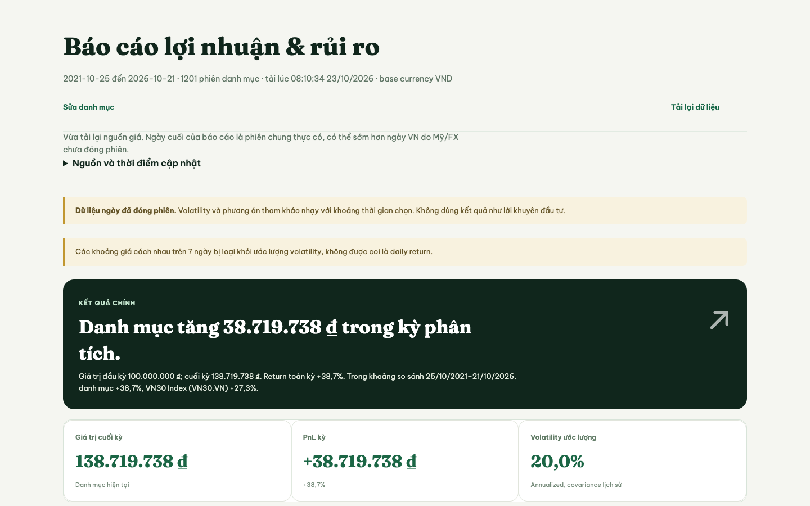

# Finfolio 2.0

**Understand where a portfolio’s historical return and risk came from before considering an allocation change.** Finfolio is a portfolio analytics application for finance students and self-directed investors who already have basic financial knowledge.

[Open the live application](https://g09-finfolio.vercel.app/) · [View the verified release](https://github.com/FTU-Legacy-63/G09/releases/tag/v2.0.0-final-20261023) · [Browse the source](demo/index.html)

## The problem Finfolio addresses

A portfolio’s total return or volatility does not show which positions drove that result. Finfolio turns supported holdings and daily market data into a report that groups return and risk contributions, compares performance with a selected benchmark, and lets users examine constrained reference allocations. The user remains responsible for any investment decision.

## What you can do

- **Analyze a hypothetical portfolio.** Enter values for supported holdings in VND or USD and review the portfolio’s VND value path, allocation, and historical price return.
- **Trace contributions.** Group return and fixed-weight risk contributions by instrument, asset class, sector, industry, market or commodity group, and listed currency where classification is available.
- **Compare performance.** Compare the portfolio with one supported benchmark over overlapping dates. Decompose the return of USD-denominated holdings into local-price, foreign-exchange, and interaction effects.
- **Examine reference allocations.** Run minimum-volatility or approximate maximum-Sharpe optimization under long-only, per-instrument, and commodity-proxy limits, then compare the historical results with the current allocation.
- **Explore sampled paths.** Run a joint moving-block bootstrap using historical returns to inspect ranges and terminal-value distributions. The simulation describes model-generated scenarios, not a forecast.

## Product preview



*Captured from the application on 23 October 2026. The figures are one historical data run; results change with the selected holdings, period, and available market data.*

## How Finfolio works

Choose 2–30 supported holdings, enter a starting value and currency for each, and select a period and benchmark. Finfolio aligns available daily closes and required USD/VND observations, converts values into VND, and derives portfolio weights. Its base analysis assumes a purchase at the first common close and holds the resulting quantities; it does not recreate a brokerage account or actual transaction history.

The report explains the result through position-level and grouped contributions. Optional optimization and simulation run separately from the initial analysis. Users can record a decision in the decision journal; Finfolio does not place trades or apply an allocation automatically.

## Supported assets and data coverage

The application supports selected Vietnam-listed equities and ETFs, selected USD-listed equities and funds, curated commodity proxies, bond and real-estate ETFs, and selected USD-denominated crypto instruments. Its curated catalog is finite and provider search does not imply full-market coverage. Index instruments can be used as benchmarks but not as portfolio holdings. Commodity and bond funds are traded proxies: they are not direct spot prices or individual bonds, and Finfolio does not look through fund holdings.

Vietnam daily data use TradingView through `tvdatafeed`, with a scheduled snapshot for a curated set of 26 Vietnam symbols and on-demand retrieval for other supported symbols. International instruments and USD/VND data use Yahoo Finance through `yfinance`. The application uses closed daily bars, not real-time prices. Providers may be delayed, unavailable, or lack a complete common history; the report shows the dates actually used and does not silently substitute test fixtures for live prices.

## Methodology at a glance

Portfolio return and position contributions use VND-converted price returns under a buy-and-hold quantity assumption. Group views aggregate the same holding-level contributions, one grouping at a time. Euler risk contributions use historical covariance and a fixed allocation; they are estimates from the selected sample, not forecasts. Benchmark comparison uses overlapping observations and does not claim a full Brinson attribution.

Optimization uses historical estimates and produces a **reference allocation**, not a recommendation. Monte Carlo resamples joint blocks of historical returns, preserving co-movement within each sampled block; it cannot represent market regimes or shocks absent from the sample. The application excludes dividends, fees, and taxes from its return calculations. See [financial methods and interpretation limits](docs/FINAL_METHODS.md), [optimization](docs/OPTIMIZATION.md), and [FX attribution](docs/FX_ATTRIBUTION.md).

## Limitations and responsible use

Finfolio analyzes hypothetical holdings and historical daily data. It does not connect to a brokerage account, execute trades, provide personalized advice, or guarantee future performance. Results depend on data coverage, the selected sample, and disclosed assumptions. Corporate actions and dividend reinvestment are not fully represented; optimization is in-sample, maximum Sharpe is approximate, Monte Carlo has no out-of-sample validation, a dedicated stress-scenario builder and full multi-period Brinson attribution are not implemented. Some risk and optimization views require longer common histories than basic allocation and return views.

## Run locally

From the repository root, install dependencies, build the browser assets, install the Python API dependencies, and start the integrated development server:

```bash
npm ci
npm run build
python3 -m pip install -r demo/requirements.txt
python3 demo/server.py
```

Then open <http://127.0.0.1:8123/portfolio>. The integrated server provides the application APIs; opening the HTML file directly or serving it with a static-only server will not provide market data. A network connection is required for live provider data. See [local development, testing, and operations](docs/DEVELOPMENT.md).

## Documentation and project evidence

| Topic | Documents |
| --- | --- |
| Current product scope and data contract | [Product scope](docs/PRODUCT_SCOPE.md) · [Data fixture notes](data/README.md) |
| Setup and financial methods | [Account setup](docs/ACCOUNT_SETUP.md) · [Final methods](docs/FINAL_METHODS.md) · [Optimization](docs/OPTIMIZATION.md) · [FX attribution](docs/FX_ATTRIBUTION.md) |
| Project requirements and weekly evidence | [Weeks 1–7](docs/WEEK1.md), [WEEK2](docs/WEEK2.md), [WEEK3](docs/WEEK3.md), [WEEK4](docs/WEEK4.md), [WEEK5](docs/WEEK5.md), [WEEK6](docs/WEEK6.md), [WEEK7](docs/WEEK7.md) |
| Group and individual evidence | [Group footprint](docs/GROUP_FOOTPRINT.md) · [Individual contribution map](docs/individual/README.md) · [V2 individual reports](academic_reports_v2/) · [Group presentation outline](docs/GROUP_PRESENTATION_SLIDEDECK.md) · [Presentation report](docs/Finfolio_2.0_Group_Presentation_SlideDeck_Report.docx) |
| Documentation audit | [Audit report and requirements traceability](docs/DOCUMENTATION_AUDIT.md) |

The weekly reports and contribution records form the academic evidence layer. They document decisions and project stages; they are not rewritten as product marketing material. Individual contributions should be read alongside their linked artefacts and personal sign-off.

## Team

Finfolio 2.0 was developed by Group G09 at Foreign Trade University. The team responsibilities are recorded in the [Group Footprint](docs/GROUP_FOOTPRINT.md), with evidence links in the [Individual Contribution Map](docs/individual/README.md).
